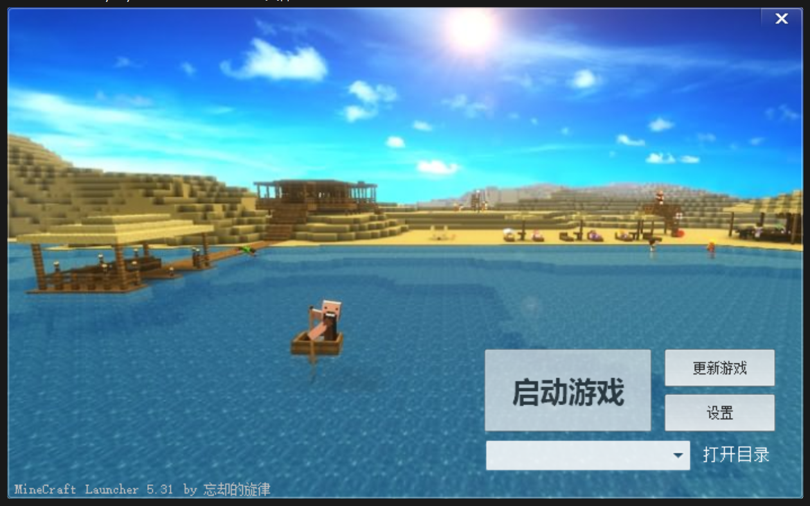
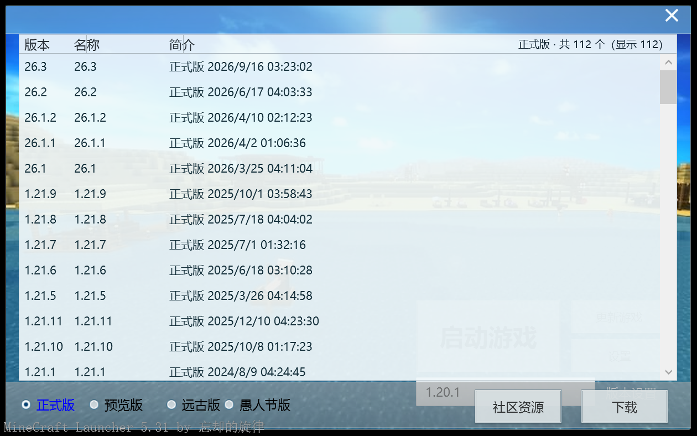
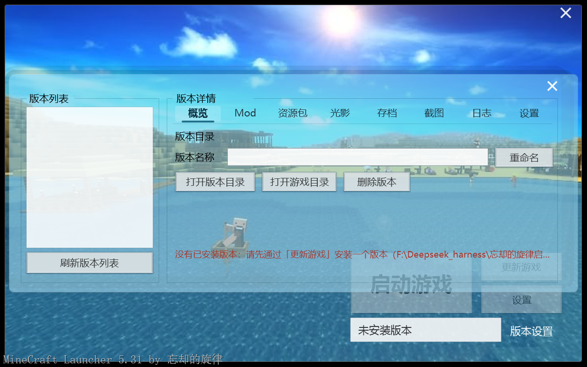
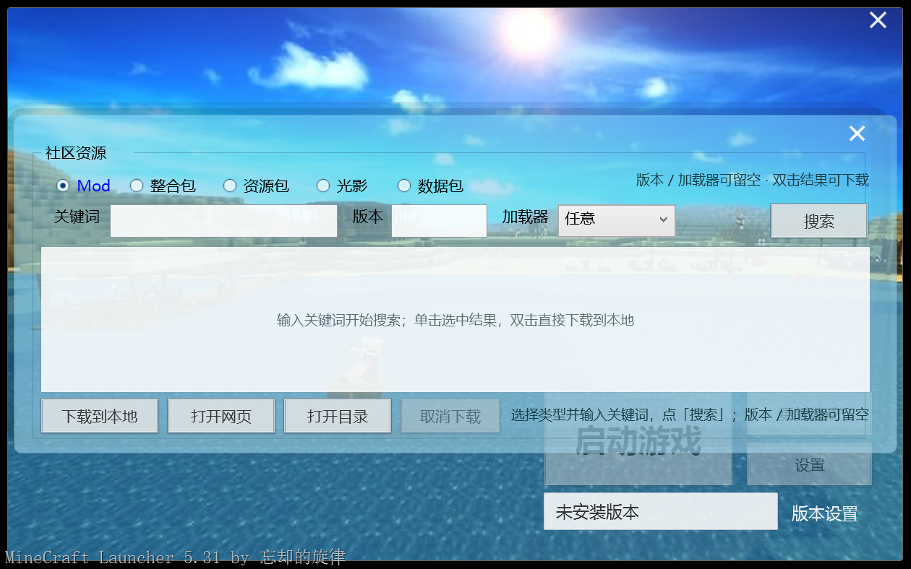
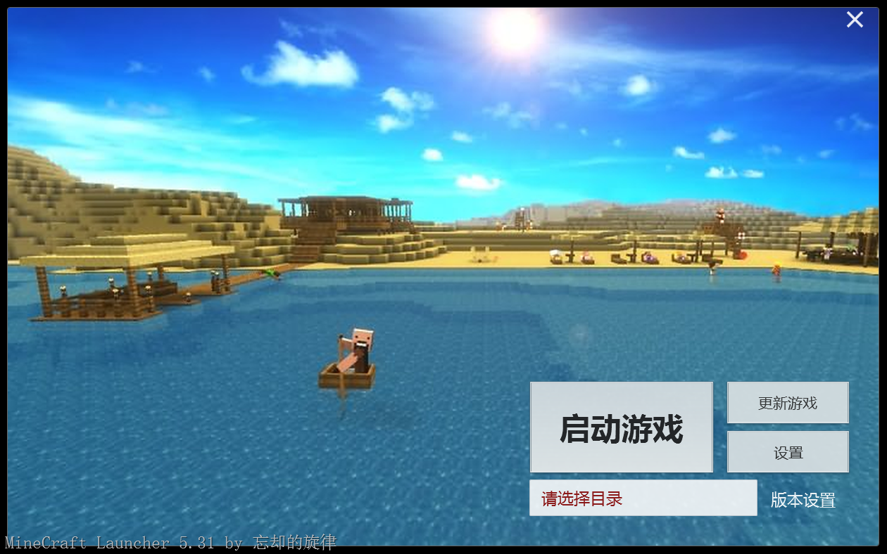

# MCLauncher 5.31 · 旋律启动器复刻



一款复刻 2014 年「旋律启动器」外观的 Minecraft 启动器：**全新 .NET 8 WPF 前端 + 内置无头启动内核**，单文件绿色版，双击即用。

> 不是换皮：界面全部由 WPF 重新实现（矢量绘制、高 DPI 原生清晰），业务逻辑通过 JSONL 协议驱动内置无头内核。

---

## 功能

| 页面 | 内容 |
|---|---|
| 主界面 | 启动游戏 / 更新游戏 / 设置 / 版本设置 / 版本显示（只读） |
| 下载中心 | 正式版 / 预览版 / 远古版 / 愚人节版 四分类；选中版本 → 下载 → 选择安装类型（原版 / Forge / Fabric / NeoForge / OptiFine / LiteLoader） |
| 版本设置 | 概览（重命名/删除/打开目录）、Mod 管理（扫描/启用/禁用）、资源包、光影、存档、截图、日志（含崩溃分析）、设置 |
| 社区资源 | Mod / 整合包 / 资源包 / 光影 / 数据包 五类搜索与下载（Modrinth），自动放入当前版本目录 |
| 下载源 API | 自动 / 官方 / 镜像 / 自定义；可编辑版本清单、Mod 镜像与 URL 重写规则，带连接测试 |
| 账户 | 微软正版登录（设备代码流程），登录后启动自动使用正版账户 |
| 其他 | 运行日志、关于、首次设置、消息框；右键菜单可打开全部子页 |

## 截图

| 主界面 | 下载中心 |
|---|---|
|  |  |

| 版本设置 | 社区资源 |
|---|---|
|  |  |

更多截图见 [docs/screenshots](docs/screenshots)。


## 便携说明（重要）

本启动器是**绿色便携版**：整个文件夹复制到任意可写位置即可使用。

- 启动器配置：`<exe 同目录>\data\settings.json`
- 游戏目录：默认 `<exe 同目录>\.minecraft`（首次启动自动创建）
- 版本显示框状态：
  - 游戏目录不存在 → 显示「请选择目录」，点击或右键菜单「选择游戏目录…」可选择
  - 目录存在但没有版本 → 显示「空」/「未安装版本」
- exe 放在不可写位置（如 Program Files）时，自动回退到
  `%LocalAppData%\MelodyLauncher`（配置）与 `%AppData%\.minecraft`（游戏目录）

| 目录缺失 | 空目录 |
|---|---|
|  |  |

## 下载

从仓库 **Releases** 下载 `MCLauncher.exe`（单文件，约 70MB，零依赖，Win10/11 直接双击运行）。

## 构建

需要 .NET 8 SDK。仓库不包含内核二进制（闭源组件，随发布包分发）；构建前把内核放到：

```
src/MelodyLauncher/engine/core.exe
```

然后：

```powershell
dotnet build src/MelodyLauncher/MelodyLauncher.csproj -c Release
dotnet publish src/MelodyLauncher/MelodyLauncher.csproj -c Release
# 产物：src/MelodyLauncher/bin/Release/net8.0-windows/win-x64/publish/MCLauncher.exe
```

## 目录结构

```
src/MelodyLauncher/    WPF 前端源码
  Assets/              背景 / 图标 / UI 切图
  Themes/              旋律风格主题与按钮模板
  Views/               主窗口与全部子页
  Services/            设置、下载源、Java 扫描、版本路径、内核客户端
docs/                  使用说明、API 说明、封面、截图
release/               发布产物（exe + SHA256）
```

## 已知限制

- CurseForge 下载需要自行配置 API Key（当前搜索使用 Modrinth）
- 微软正版登录需要在浏览器完成一次设备代码授权
- 无自动更新、无数字签名；部分杀软可能对「释放内核再执行」误报
- 版本隔离默认开启（与上游内核默认一致），Mod/存档位于 `versions/<版本>/` 下

---

作者：忘却的旋律
